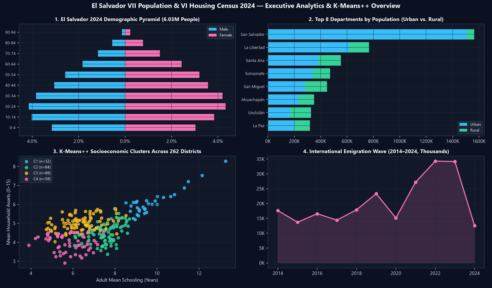

# Censo de El Salvador 2024 (`el-salvador-census-2024-segmentation`)

> **Idioma:** [English (`README.md`)](README.md) | **Español**
>
> **Tablero interactivo bilingüe (`EN / ES`):** [`index.html`](index.html) · [Versión en vivo en GitHub Pages](https://saul2703.github.io/el-salvador-census-2024-segmentation/)
> **Fuente oficial (`BCR / ONEC`):** [CPV 2024 Bases de Datos y Tabulados](https://poblacion.bcr.gob.sv/pages/teg-base-de-datos-y-tabulados)

---

## Qué Descubrí en los 10.51 Millones de Registros (En Palabras Sencillas)

Leí los **5 archivos CSV oficiales** del VII Censo de Población y VI de Vivienda 2024 (`171.8 MB` comprimidos en ZIP, `2.17 GB` descomprimidos) sin perder un solo registro:

1. **Población total exacta (`5,922,921 + 107,055 = 6,029,976` habitantes):**  
   `5,922,921` personas viven en los **262 distritos** geográficos (agrupados en **44 municipios** y **14 departamentos**), y `107,055` personas están registradas en **14 centros colectivos penitenciarios** bajo el código especial `150101` (`Depto. 15`). Al dejar `150101` aparte antes de modelar, no se distorsionan los promedios de ningún pueblo.

2. **La paradoja de las remesas (`MCO R² = 0.7908`):**  
   En los **88 distritos rurales con altas remesas** (**45.15%** de hogares recibe ayuda familiar del exterior), la escolaridad promedio es menor (**6.38 años** vs **7.57 años** en zonas semiurbanas), pero esos hogares tienen **más electrodomésticos** (**5.03 vs 4.50**) y **más internet** (**31.09% vs 23.94%**). En la regresión estandarizada (`1,000` remuestreos Bootstrap), las **remesas (`β = 0.7088`)** pesan prácticamente lo mismo que la **escolaridad adulta (`β = 0.7092`)** para explicar el patrimonio del hogar.

3. **Cuatro tipos de distritos en El Salvador (`K-Means++`, `k = 4`):**  
   - **C1 Centros Metropolitanos y Alta Capitalización (`32` distritos):** Mayor escolaridad, agua entubada e internet (`59%`).  
   - **C2 Corredores Semiurbanos de Conmutación (`84` distritos):** Alta proporción de empleo formal y trabajadores que viajan a otro municipio.  
   - **C3 Pueblos Transnacionales por Remesas (`88` distritos):** Alta entrada de remesas (**45.15%**), mayor equipamiento del hogar e internet pese a menor escolaridad.  
   - **C4 Zonas Rurales Agrícolas Vulnerables (`58` distritos):** Menor acceso a internet, agua por cañería y equipamiento del hogar.

---

## Estructura y Verificación

- [`index.html`](index.html) — Tablero interactivo (`EN / ES`, modo claro/oscuro, gráficos SVG en vivo, tablas AG Grid y esquema SQL).
- [`src/census_analysis.py`](src/census_analysis.py) — Pipeline Python en *streaming* por bloques sobre el ZIP oficial del BCR.
- [`data/census_summary.json`](data/census_summary.json) — Resumen validado de los 262 distritos, 44 municipios y regresiones MCO.
- [`sql/cpv2024_star_schema.sql`](sql/cpv2024_star_schema.sql) — Esquema estrella SQL (`dim_geography`, hechos de hogares/distritos).
- [`verify.mjs`](verify.mjs) — Pruebas automáticas de conciliación censal y estructura del tablero (`node verify.mjs`).
