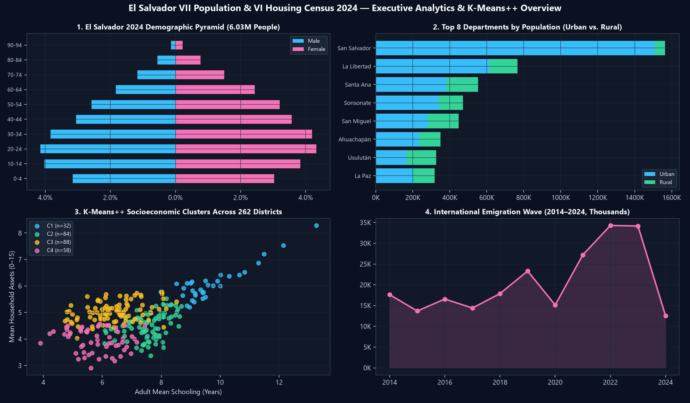
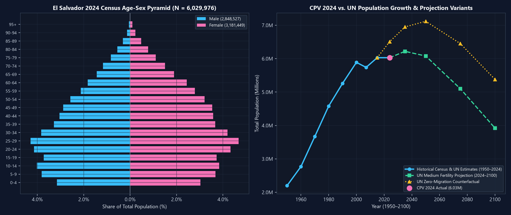
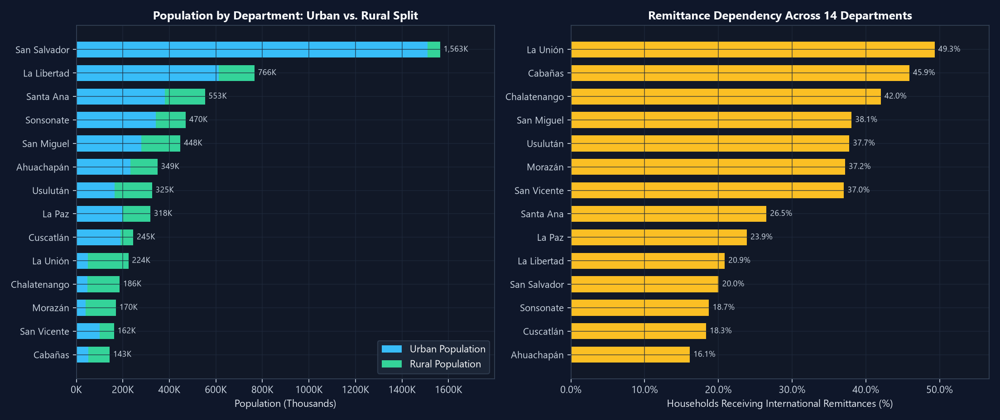
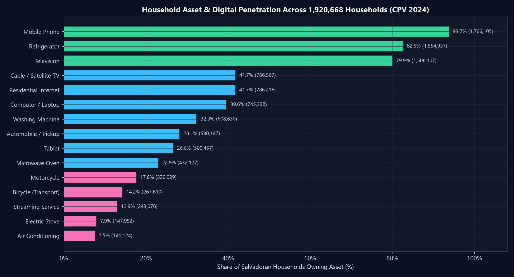
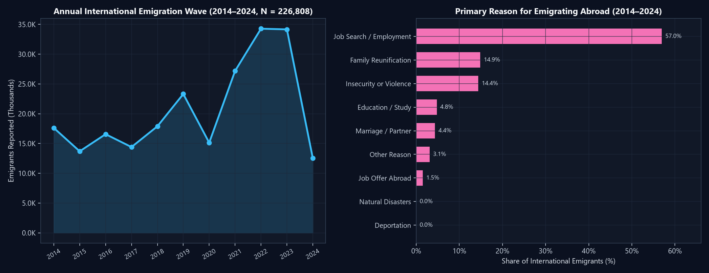
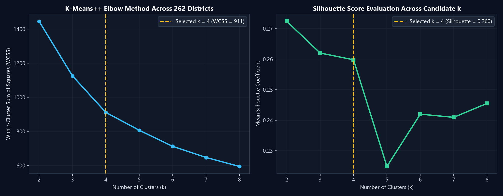
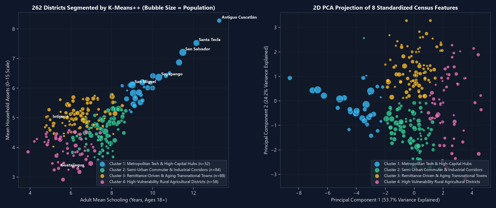

# El Salvador 2024 Census Analytics & K-Means++ Segmentation (`el-salvador-census-2024-segmentation`)

> **Strategic Repository Name:** `el-salvador-census-2024-segmentation`
> **GitHub Description:** `End-to-end demographic analytics & unsupervised K-Means++ segmentation of El Salvador's 2024 Census (10.51M records, 262 districts) with Star Schema SQL, 2D PCA & AG Grid.`
> **Topics:** `el-salvador` · `census-2024` · `kmeans-clustering` · `pca` · `python` · `star-schema` · `ag-grid` · `data-science-portfolio`

> **End-to-End Demographic & Socioeconomic Data Science Case Study:** Direct ZIP-streamed aggregation across all **5 official El Salvador 2024 Census (`CPV2024SV`) microdata tables** (**6,029,976 individuals**, **1,920,668 households**, **2,270,026 dwellings**, **226,808 international emigrants**, and **63,267 recent mortality records** = **10,510,745 total census records**), benchmarked against **UN Population Division (1950–2100)** trajectories and segmented across all **262 Districts** and **44 Restructured Municipalities** via unsupervised **K-Means++** & **2D SVD Principal Component Analysis**.

<picture>
  <source media="(prefers-color-scheme: dark)" srcset="images/dashboard_overview_preview.png" />
  <source media="(prefers-color-scheme: light)" srcset="images/dashboard_overview_preview_light.png" />
  
</picture>

- **Interactive AG Grid HTML5 Dashboard:** [`index.html`](index.html)
- **Official Data Source:** [Banco Central de Reserva (BCR) / Oficina Nacional de Estadística y Censos (ONEC) — VII Censo de Población y VI de Vivienda 2024](https://geoportal.bcr.gob.sv/)
- **Reproducible Streaming & K-Means++ Pipeline:** [`src/census_analysis.py`](src/census_analysis.py)
- **Aggregated District, Municipality & Cluster JSON:** [`data/census_summary.json`](data/census_summary.json)

---

## Table of Contents
1. [Executive Problem Statement & Objectives](#1-executive-problem-statement--objectives)
2. [Complete English Schema Across All 5 CPV 2024 Datasets](#2-complete-english-schema-across-all-5-cpv-2024-datasets)
3. [Synthesis with External GitHub Benchmarks](#3-synthesis-with-external-github-benchmarks)
4. [Exploratory Demographic, Infrastructure & Migration Findings](#4-exploratory-demographic-infrastructure--migration-findings)
5. [Unsupervised Machine Learning: K-Means++ District Segmentation](#5-unsupervised-machine-learning-k-means-district-segmentation)
6. [Actionable Policy & Commercial Territory Recommendations](#6-actionable-policy--commercial-territory-recommendations)
7. [Repository Structure & Reproducible Verification](#7-repository-structure--reproducible-verification)

---

## 1. Executive Problem Statement & Objectives

In 2024, El Salvador completed its first national Population and Housing Census in 17 years (**CPV 2024**, following the 2007 census), coinciding with the country's territorial reorganization from **262 historical municipalities (now *distritos*)** into **44 new municipalities** across **14 departments** (*Ley Especial para la Reestructuración Municipal*).

Public-sector planners, infrastructure investors, and commercial territory managers need data-backed answers to five core questions:
1. **Population Reconciliation & Demographic Transition:** How does El Salvador's enumerated 2024 population (**6,029,976**) reconcile across residential districts versus institutional collective dwellings, and how does the age-sex pyramid compare to **UN Population Division (1950–2100)** projections?
2. **The Digital & Household Asset Divide:** Across **1,920,668 households** and **15 tracked durable assets**, which assets have reached near-universal saturation and which define socioeconomic stratification?
3. **Transnational Migration & Remittance Dependency:** How did the **2014–2024 international emigration wave (226,808 reported emigrants)** reshape the age structure and household asset wealth of high-emigration rural districts?
4. **Unsupervised K-Means++ Territorial Segmentation:** Can we cluster all **262 districts** across 8 continuous, standardized indicators spanning human capital, household assets, broadband, water/cooking infrastructure, remittances, and demographic aging?
5. **Zero-Backend Self-Service BI:** How can decision-makers drill into all **262 districts** and **44 restructured municipalities** with instant sorting, cluster filtering, and CSV export?

---

## 2. Complete English Schema Across All 5 CPV 2024 Datasets

Because `Bases-Finales-CPV2024SV-CSV.zip` is **171.8 MB compressed (2.17 GB uncompressed)**, [`src/census_analysis.py`](src/census_analysis.py) streams all 5 CSV files directly from the ZIP archive in 500k–750k row chunks without extracting 2.17 GB onto disk.

| # | CSV Table in Archive | English Entity | Records | Columns | Primary Key | Foreign Join Key |
| :- | :--- | :--- | ---: | ---: | :--- | :--- |
| **1** | `Base de Datos de Viviendas - CPV 2024 SV.csv` | **Dwellings** | 2,270,026 | 35 | `COD_VIV` (14-char) | `DISTODESC` (6-char) |
| **2** | `Base de Datos de Hogares - CPV 2024 SV.csv` | **Households** | 1,920,668 | 36 | `COD_HOG` (16-char) | `COD_VIV` (14-char) |
| **3** | `Base de Datos de Población - CPV 2024 SV.csv` | **Population** | 6,029,976 | 90 | `COD_PER` (21-char) | `COD_HOG` (16-char) |
| **4** | `Base de Datos de Mortalidad - CPV 2024 SV.csv` | **Mortality (12m)** | 63,267 | 17 | `COD_MORT` (18-char) | `COD_HOG` (16-char) |
| **5** | `Base de Datos de Emigración Internacional - CPV 2024 SV.csv` | **Emigration (2014–24)** | 226,808 | 18 | `COD_EMIG` (18-char) | `COD_HOG` (16-char) |

### Key Data Engineering Reconciliation (`5,922,921 + 107,055 = 6,029,976`)
Auditing `DEPTODESC` and `DISTODESC` across `Viviendas` and `Población` surfaces an essential structural detail in the BCR microdata:
- **`5,922,921` residents** live across the **262 geographic districts** in Departments `01` through `14`.
- **`107,055` individuals** are recorded in **14 collective penitentiary records** (`V01_VIV = 2 [Collective]`, `V01_2_VIV_COLECTIVA = 3 [Penitentiary / Detention Center]`) assigned to special non-geographic code **`DEPTODESC = 15` (`DISTODESC = 150101`)** so institutional prison populations do not distort local municipal per-capita rates.
- Excluding `150101` prior to Z-score standardization prevents a 107,055-person zero-household outlier from distorting K-Means++ centroids.

---

## 3. Synthesis with External GitHub Benchmarks

1. **[`datasets/population-growth-estimates-and-projections`](https://github.com/datasets/population-growth-estimates-and-projections) (UN Population Division, 1950–2100):**
   - Provides longitudinal country-level estimates and projection variants (*Medium Fertility*, *Zero Migration*, *Constant Fertility*).
   - Plotting CPV 2024's actual count (**6.03M**) against the UN's *Zero-Migration Counterfactual* (**~6.51M in 2024**) visually demonstrates how international out-migration and declining fertility (`0–4` cohort = `373,233` vs. `25–29` cohort = `540,516`) have flattened El Salvador's total population curve ahead of schedule.
2. **[`KarinaSamsonova/mall-customer-segmentation`](https://github.com/KarinaSamsonova/mall-customer-segmentation) (Unsupervised K-Means Portfolio Workflow):**
   - Adapts the classic unsupervised clustering narrative (*Feature Engineering & Sentinel Cleaning $\rightarrow$ Z-Score Standardization $\rightarrow$ WCSS Elbow & Silhouette Evaluation $\rightarrow$ 2D PCA Projection $\rightarrow$ Actionable Personas*) from a 200-row toy dataset to a **10.51-million-record national census**.
   - Avoids a common LLM census pitfall: raw CPV 2024 binary/categorical fields encode `1 = Yes`, `2 = No`, and `9` or `99 = Unknown`. Running Euclidean K-Means on raw integer codes clusters on missing-value sentinels (`99`). Instead, we compute clean continuous district rates (`0–100%` and valid means) over non-missing denominators before Z-score scaling.
3. **[`stefanovertua/Pizza-Pioneers-Sales-Operations-Analysis-Power-BI-Dashboard`](https://github.com/stefanovertua/Pizza-Pioneers-Sales-Operations-Analysis-Power-BI-Dashboard) (Executive Summary vs. Top/Bottom Operations Matrix):**
   - Separates the BI workbench into an **Executive & K-Means++ Overview** tab and a dedicated **Top 5 Leaders vs. Bottom 5 High-Vulnerability Performers Matrix** across 4 operational dimensions (*Adult Schooling Years*, *Household Durable Asset Index*, *Residential Broadband %*, and *International Remittance %*) to guide infrastructure capex and commercial territory sizing.
4. **[`weismanm12/finances-database`](https://github.com/weismanm12/finances-database) (Relational Star Schema DDL, SQL Views & Automated ETL Validation):**
   - Normalizes the 5 raw CPV 2024 CSV exports into a formal relational Star Schema ([`sql/cpv2024_star_schema.sql`](sql/cpv2024_star_schema.sql)) with 3 Dimension tables (`dim_geography`, `dim_dwellings`, `dim_households`), 3 Fact tables (`fact_population`, `fact_international_emigration`, `fact_mortality`), and analytical SQL views (`vw_district_kmeans_features`, `vw_remittance_asset_paradox`).
   - Enforces runtime schema and boundary validation via `DistrictSchemaContract` plus deterministic **Spanish-to-English survey sentence transformation** (`SPANISH_TO_ENGLISH_SENTENCES` in [`src/census_analysis.py`](src/census_analysis.py)).

---

## 4. Exploratory Demographic, Infrastructure & Migration Findings

### 4.1 Age-Sex Pyramid & UN Projection Comparison
<picture>
  <source media="(prefers-color-scheme: dark)" srcset="images/demographic_pyramid_and_un_projections.png" />
  <source media="(prefers-color-scheme: light)" srcset="images/demographic_pyramid_and_un_projections_light.png" />
  
</picture>

- **Rapid Base Contraction:** The `0–4` age cohort (**373,233**, `6.19%` of population) is **31.0% smaller** than the peak `25–29` cohort (**540,516**, `8.96%`), confirming a sharp drop in total fertility toward replacement level.
- **Gender Asymmetry:** El Salvador's population is **52.55% female** (`3,168,895` females vs. `2,861,081` males), with the female share rising steadily past age 20 due to male-skewed international emigration and higher male external mortality.

### 4.2 Department Urbanization & Remittance Dependency
<picture>
  <source media="(prefers-color-scheme: dark)" srcset="images/department_population_and_remittances.png" />
  <source media="(prefers-color-scheme: light)" srcset="images/department_population_and_remittances_light.png" />
  
</picture>

- **Metropolitan Concentration:** **San Salvador** (**1,563,371** residents across 19 districts, `96.2%` urban) and **La Libertad** (**765,879** residents across 22 districts, `81.8%` urban) together house **39.3% of El Salvador's residential population**.
- **Eastern & Northern Remittance Belt:** While **26.33%** of households receive international remittances nationally, household remittance penetration reaches **47.5% in La Unión**, **42.8% in Morazán**, **42.3% in Cabañas**, **40.3% in Chalatenango**, and **39.4% in San Miguel**.

### 4.3 Household Asset Penetration & The Digital Divide (`1,920,668` Households)
<picture>
  <source media="(prefers-color-scheme: dark)" srcset="images/household_assets_digital_divide.png" />
  <source media="(prefers-color-scheme: light)" srcset="images/household_assets_digital_divide_light.png" />
  
</picture>

| Asset Tier | Census Indicator (`Hogares`) | Households Owning | National Penetration (%) |
| :--- | :--- | ---: | ---: |
| **Tier 1: Near-Universal Staples (>75%)** | Mobile Phone (`H02_7_HOG_CEL`) | 1,766,105 | **93.74%** |
| | Refrigerator (`H02_1_HOG_REFRI`) | 1,554,937 | **82.53%** |
| | Television (`H02_6_HOG_TV`) | 1,506,107 | **79.94%** |
| **Tier 2: Middle-Class & Digital Divide (25%–45%)** | Cable / Satellite TV (`H02_10_HOG_CABLETV`) | 786,567 | **41.75%** |
| | Residential Internet (`H02_11_HOG_INTERNET`) | 786,216 | **41.73%** |
| | Desktop / Laptop Computer (`H02_8_HOG_COMPU`) | 745,398 | **39.56%** |
| | Washing Machine (`H02_2_HOG_LAVADORA`) | 608,630 | **32.30%** |
| | Automobile / Pickup (`H02_13_HOG_AUTO`) | 530,147 | **28.14%** |
| | Tablet (`H02_9_HOG_TABLET`) | 500,457 | **26.56%** |
| **Tier 3: Discretionary & Transport (<25%)** | Microwave Oven (`H02_3_HOG_MICRO`) | 432,127 | **22.94%** |
| | Motorcycle (`H02_15_HOG_MOTOCICLETA`) | 330,929 | **17.56%** |
| | Bicycle for Transport (`H02_14_HOG_BICICLETA`) | 267,610 | **14.20%** |
| | Streaming Subscription (`H02_12_HOG_PLATAFORMAS`) | 243,076 | **12.90%** |
| | Electric Stove (`H02_4_HOG_COCINA`) | 147,952 | **7.85%** |
| | Air Conditioning (`H02_5_HOG_AC`) | 141,124 | **7.49%** |

### 4.4 International Emigration Trajectory (`2014–2024`, `N = 226,808`)
<picture>
  <source media="(prefers-color-scheme: dark)" srcset="images/international_emigration_trends.png" />
  <source media="(prefers-color-scheme: light)" srcset="images/international_emigration_trends_light.png" />
  
</picture>

- **Destination Concentration:** **85.91% (`194,849`)** of emigrants relocated to the **United States**, followed by **Spain (`9,142`, 4.03%)**, **Italy (`4,468`, 1.97%)**, **Mexico (`3,997`, 1.76%)**, and **Canada (`2,543`, 1.12%)**.
- **Primary Drivers:** **Job Search / Employment (`129,172`, 56.95%)** dominates, followed by **Family Reunification (`33,731`, 14.87%)** and **Insecurity or Violence (`32,647`, 14.39%)**. Annual departures peaked in **2022 (`34,284`)** and **2023 (`34,168`)**.

---

## 5. Unsupervised Machine Learning: K-Means++ District Segmentation

### 5.1 Selecting Optimal $k$ (WCSS Elbow & Silhouette Evaluation)
<picture>
  <source media="(prefers-color-scheme: dark)" srcset="images/elbow_silhouette_evaluation.png" />
  <source media="(prefers-color-scheme: light)" srcset="images/elbow_silhouette_evaluation_light.png" />
  
</picture>

We standardized 8 continuous district-level indicators (`mean_schooling_yrs`, `literacy_rate_pct`, `mean_hh_assets`, `internet_hh_pct`, `piped_water_pct`, `firewood_cooking_pct`, `remittance_hh_pct`, `mean_age`) across all **262 districts** and evaluated K-Means++ across $k \in \{2, \dots, 8\}$ (50 random restarts per $k$):
- **$k = 2$** (`WCSS = 1,445.4`, `Silhouette = 0.2724`) provides a binary urban-versus-rural split.
- **$k = 4$** (`WCSS = 911.1`, `Silhouette = 0.2598`) captures the primary WCSS elbow before the Silhouette drop at $k = 5$ (`0.2249`), cleanly separating **transnational remittance towns (Cluster 3)** from **semi-urban commuter belts (Cluster 2)** and **high-vulnerability rural agricultural districts (Cluster 4)**.

### 5.2 Cluster Profiles & 2D SVD Principal Component Analysis
<picture>
  <source media="(prefers-color-scheme: dark)" srcset="images/district_kmeans_clusters_pca.png" />
  <source media="(prefers-color-scheme: light)" srcset="images/district_kmeans_clusters_pca_light.png" />
  
</picture>

The first two principal components explain **77.91% of total variance across all 262 districts**:
- **`PC1` (53.70% variance):** Urban Human Capital, Broadband & Infrastructure Development (`+Schooling`, `+Assets`, `+Internet`, `-Firewood`).
- **`PC2` (24.21% variance):** Transnational Emigration, Remittances & Demographic Aging (`+Remittance %`, `+Mean Age`, `+Emigration Rate`).

| Cluster Persona | Districts ($n$) | Population | Households | Adult Schooling | Literacy % | Mean Assets (0–15) | Internet % | Piped Water % | Firewood % | Remittance % | Emigrants / 1k |
| :--- | ---: | ---: | ---: | ---: | ---: | ---: | ---: | ---: | ---: | ---: | ---: |
| **Cluster 1: Metropolitan Tech & High-Capital Hubs** | 32 | 2,475,756 (41.8%) | 814,848 | **9.69 yrs** | **94.31%** | **6.09** | **54.74%** | **70.40%** | **3.55%** | 24.22% | 34.76 |
| **Cluster 2: Semi-Urban Commuter & Industrial Corridors** | 84 | 1,779,703 (30.0%) | 567,967 | **7.57 yrs** | **90.00%** | **4.50** | **23.94%** | **38.48%** | **13.13%** | 20.63% | 33.92 |
| **Cluster 3: Remittance-Driven & Aging Transnational Towns** | 88 | 1,059,669 (17.9%) | 349,341 | **6.38 yrs** | **83.83%** | **5.03** | **31.09%** | **46.28%** | **15.65%** | **45.15%** | **68.90** |
| **Cluster 4: High-Vulnerability Rural Agricultural Districts** | 58 | 607,793 (10.3%) | 188,512 | **5.81 yrs** | **81.23%** | **3.96** | **14.89%** | **31.75%** | **32.68%** | 32.87% | 58.76 |

### Key Unsupervised ML Insight: The "Remittance Paradox" Between Cluster 2 and Cluster 3
Compare **Cluster 2 (Semi-Urban Commuter Corridors)** and **Cluster 3 (Remittance-Driven Transnational Towns)**:
- Cluster 3 is overwhelmingly rural (**20.84% urban** vs. **59.95% urban** in Cluster 2) and has lower formal schooling (**6.38 yrs** vs. **7.57 yrs**) and literacy (**83.83%** vs. **90.00%**).
- **Yet Cluster 3 owns MORE household appliances/assets (`5.03` vs. `4.50`), has +7.15 percentage points higher residential internet penetration (`31.09%` vs. `23.94%`), and +7.80 pp higher indoor piped water (`46.28%` vs. `38.48%`)!**
- **Why?** Because **45.15% of Cluster 3 households receive foreign remittances** (reaching `65%–72%` in landmark districts like *Intipucá*, *Concepción de Oriente*, and *Yayantique*), funding private household durable goods, home internet, and water upgrades despite low local formal schooling and an aging population (**35.04 yrs** mean age).

---

## 6. Actionable Policy & Commercial Territory Recommendations

1. **Broadband & Last-Mile ISP Expansion in Cluster 3 Transnational Towns (349,341 Households):**
   - *Finding:* Cluster 3 households already exhibit high disposable purchasing power for appliances (`5.03` assets, `45.15%` remittance receipt) and high demand for international video communication, yet residential broadband stands at `31.09%`.
   - *Action:* Telecom and fiber/fixed-wireless ISPs should prioritize Cluster 3 municipal centers (La Unión, Morazán, Cabañas, Chalatenango) for remittance-bundled home internet and smart-device packages.
2. **Clean Cooking (LPG) & Piped Water Infrastructure Targeting in Cluster 4 (58 Districts, 188,512 Households):**
   - *Finding:* Across Cluster 4 rural districts, **32.68% of occupied dwellings still rely on firewood (*leña*) for cooking** and only **31.75% have piped water inside the dwelling**.
   - *Action:* Direct municipal water infrastructure capex and clean-cooking LPG subsidies specifically to the 58 Cluster 4 districts rather than using broad department-level averages.
3. **Technical & Vocational Upskilling Along Cluster 2 Industrial Corridors (84 Districts, 1.78M Residents):**
   - *Finding:* Cluster 2 districts have a young working-age profile (`33.27 yrs` mean age) and high basic literacy (`90.00%`), but trail Cluster 1 in average schooling (`7.57` vs. `9.69` years) and home computer ownership (`23.94%` internet).
   - *Action:* Locate public-private technical institutes, bilingual call-center training, and logistics parks along Cluster 2 commuter hubs (*La Libertad Centro/Norte*, *Sonsonate Centro/Este*, *San Salvador Norte/Sur*).

---

## 7. Repository Structure & Reproducible Verification

```text
el-salvador-census-2024-segmentation/
├── images/
│   ├── dashboard_overview_preview.png            # 4-panel executive summary hero banner
│   ├── demographic_pyramid_and_un_projections.png # 2024 Age-Sex Pyramid + UN 1950-2100 curves
│   ├── department_population_and_remittances.png  # 14 Departments Urban/Rural & Remittance %
│   ├── household_assets_digital_divide.png        # 15 Household Asset penetration rates (1.92M HHs)
│   ├── international_emigration_trends.png        # 2014-2024 Emigration wave & primary causes
│   ├── elbow_silhouette_evaluation.png            # K-Means++ WCSS Elbow & Silhouette curve (k=2..8)
│   └── district_kmeans_clusters_pca.png           # 262 Districts K-Means++ scatter & 2D SVD PCA
├── data/
│   └── census_summary.json                        # Aggregated metrics across 262 districts & 44 munis
├── sql/
│   └── cpv2024_star_schema.sql                    # Relational Star Schema DDL & analytical views
├── src/
│   └── census_analysis.py                         # Zero-extraction ZIP streaming, validation & K-Means++
├── index.html                                     # Self-contained AG Grid Community HTML5 Workbench
├── verify.mjs                                     # Automated data reconciliation & HTML5 verification suite
├── PRODUCT.md                                     # Product context & surface mode specification
├── DESIGN.md                                      # Operate-mode design tokens & typography contract
├── .gitignore                                     # Excludes 171.8 MB raw CPV 2024 ZIP archive
└── README.md                                      # Complete English Case Study & Schema Reference
```

### Run the Analysis, Verification & Publish to GitHub

```powershell
# 1. Stream all 5 CSVs from Bases-Finales-CPV2024SV-CSV.zip & regenerate all charts (~85-125s)
uv run --with pandas --with numpy --with matplotlib python src/census_analysis.py

# 2. Run the automated verification check (validates 6,029,976 population reconciliation, clusters, charts & HTML)
node verify.mjs

# 3. Publish as a standalone GitHub repository (excludes the 171.8 MB ZIP via .gitignore)
winget install --id Git.Git -e; winget install --id GitHub.cli -e
git init
git add .
git commit -m "Add El Salvador 2024 Census (10.51M records) K-Means++ segmentation, Star Schema SQL, and AG Grid dashboard"
gh auth login
gh repo create el-salvador-census-2024-segmentation --public --description "End-to-end demographic analytics & unsupervised K-Means++ segmentation of El Salvador's 2024 Census (10.51M records, 262 districts) with Star Schema SQL, 2D PCA & AG Grid." --source=. --remote=origin --push
```
